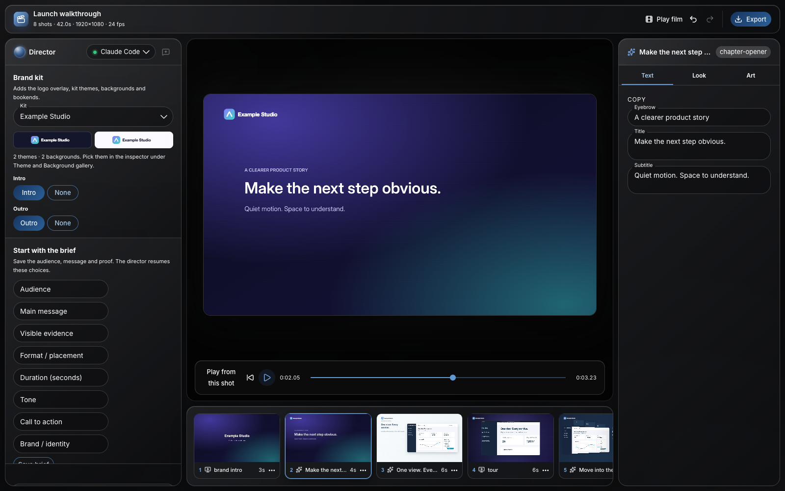

# JoeFlux

**Silent product videos from editable scenes, directed by you and your AI agent.**

JoeFlux is a local studio for product demos and explainers. Turn screen recordings and product stories into polished silent MP4s, refine them in the Studio or with an AI director, and render from plain project files you can read, diff and commit.



## Highlights

- **Editable scenes.** Every shot is JSON evaluated by frame. Copy, media, layout and timing stay editable until export.
- **AI director.** Claude Code, Codex or Copilot CLI edit through the same validated, undoable tools as the Studio.
- **Drop-in brand kits.** Logos, fonts, themes, backgrounds and intro/outro clips live in one folder that any project can use.
- **After Effects friendly.** Play Bodymovin (Lottie) exports frame-accurately or bring rendered clips in as shots and bookends.
- **Same frames everywhere.** One browser renderer serves the stage, thumbnails and the H.264 exporter.
- **Open source, MIT animation stack.** Anime.js, Motion, Three.js, React Three Fiber and lottie-web, all bundled and pinned.

## Quick start

Requires Node.js 22.13+, pnpm 10.12.4 and FFmpeg/FFprobe on your `PATH`.

```sh
pnpm install --frozen-lockfile
pnpm exec playwright install chromium
pnpm run doctor
pnpm run preview -- projects/motion-showcase
```

Open the printed link. Create your own project with:

```sh
pnpm run init -- projects/first-video
pnpm run preview -- projects/first-video
```

Render, assemble and review:

```sh
pnpm run render -- projects/first-video
pnpm run assemble -- projects/first-video
pnpm run review -- projects/first-video
```

## Brand kits

```sh
pnpm run brand -- new acme --name "Acme"   # scaffold brand-kits/acme
# add logos, fonts, backgrounds and bookends, describe them in brand.json
pnpm run brand -- sync                     # validate and register every kit
```

`brand-kits/example` is a complete original kit to copy from.

## Documentation

The full documentation, with screenshots, architecture diagrams and the agent token budget, is a Docusaurus site in `website/`:

```sh
pnpm run docs:install
pnpm run docs:dev        # http://localhost:3000
```

| Topic | Page |
| --- | --- |
| Install and first video | `website/docs/getting-started/` |
| Studio tour and AI director | `website/docs/studio/` |
| Brand kits and `brand.json` | `website/docs/brand-kits/` |
| After Effects and Lottie | `website/docs/motion/after-effects.md` |
| Architecture and token efficiency | `website/docs/architecture/` |
| Commands, tools and themes | `website/docs/reference/` |

## Project layout

```text
apps/          Studio (React + Oxygen UI) and the classic preview
packages/      core, schema, motion, renderer, tools, mcp, agents, presets and more
brand-kits/    drop-in brand kits and the generated registry
library/       built-in templates and knowledge notes
skills/        production skills for agents (mirrored in .claude/ and .agents/)
projects/      sample projects
templates/     the starter project used by init
website/       documentation site
```

## Development

```sh
pnpm test            # full suite
pnpm run test:fast   # skips the slow browser and render suites
pnpm run build:studio
pnpm run build:plugins
pnpm run licenses:check
pnpm plugin:check fixtures/plugins/proof-pack
```

JoeFlux is silent-video only: projects require `output.audio: false` and exports contain no audio stream.

## License

Code is [MIT](LICENSE). Third-party components, fonts and media keep their own terms; see [THIRD_PARTY_NOTICES.md](THIRD_PARTY_NOTICES.md).
