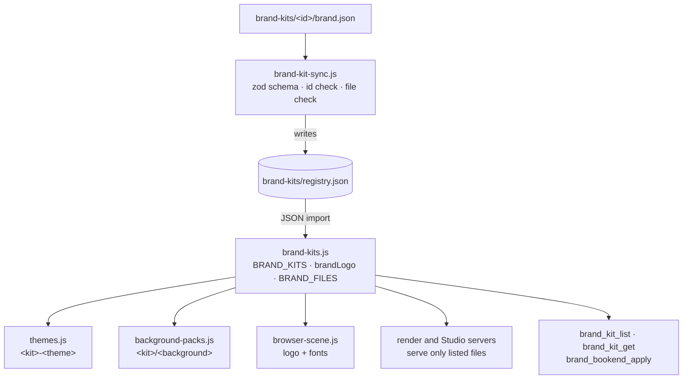

# Brand kit registry

## Why a generated registry

Themes, backgrounds and logos are needed synchronously in three environments: Node (tools and validation), the Vite-built Studio and the raw ES modules loaded by the render page. A single JSON file imported with `import … with { type: 'json' }` works in all three without a build step, and the renderer's module graph stays static and cacheable. `sync` is the only code that reads the filesystem.

## Validation

`packages/presets/src/brand-kit-sync.js` parses each `brand.json` with a strict zod schema, fills defaults, rejects ids that don't match their folder, duplicate ids, paths that leave the kit and missing files, and reports every problem at once. A test fails if the committed registry no longer matches the folders.

## Serving files

The render server and the Studio servers serve `/brand-kits/<kit>/<file>` only for files named in the registry, with a content type chosen by extension. Guidelines are not served to the browser; agents read them through `brand_kit_get`.

## Rendering

For a shot whose effective brand is a kit, the renderer picks the logo for the theme's mode, decodes it once and places it on the spatial stage at the kit's corner, width and margin, in 1920-wide design pixels. Fonts named in the active theme's font stack load through the FontFace API before text is measured.

## Cache and portability

The engine fingerprint includes the whole `brand-kits` folder, so changing a kit re-renders affected shots. Bookends are copied into the project when added, so a finished project renders without the original kit.
