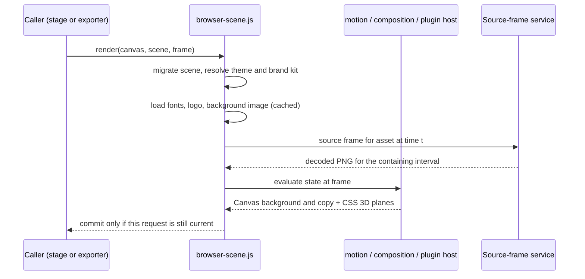

# Frame pipeline

## One renderer for everything

`packages/renderer/src/browser-scene.js` is loaded by the Studio stage, every shot thumbnail and the export page. It prepares fonts, logos, background images and decoded source frames first, then commits the frame only if the request is still the latest one. Rapid scrubbing never paints a stale frame.

Canvas draws the background and copy. `motion/src/spatial-stage.js` renders recordings as CSS perspective planes with chrome, shadow and caption, and places the brand kit logo. An optional WebGL pass grades the base canvas with a LUT, soft focus and light; screens, captions and artwork are composited after it.

## Source frames

`decoder.js` probes a recording's presentation timestamps with FFprobe and decodes it to PNG frames once, into the project's `.runtime/source-frames`. A request for time *t* returns the frame whose interval contains *t*, so variable-frame-rate recordings stay in sync. Preview and export use the same service.

## Export

`render.js` opens the render page in headless Chromium through Playwright, renders every frame and pipes them into FFmpeg as H.264 (BT.709, no audio). Motion blur renders extra sub-frames and averages them. Cancelling a render removes partial output.

## Cache identity

A clip is reused when its fingerprint matches:

| Input | Included |
| --- | --- |
| Output settings, theme and brand | yes |
| The scene JSON | yes |
| Every asset the scene references, by content hash | yes |
| Custom modules and their declared dependencies | yes |
| Renderer, motion, preset, schema and plugin source, the render page and bundled fonts | yes |
| Installed brand kits | yes |

Hashes are cached by size and modification time, so unchanged projects fingerprint quickly.
