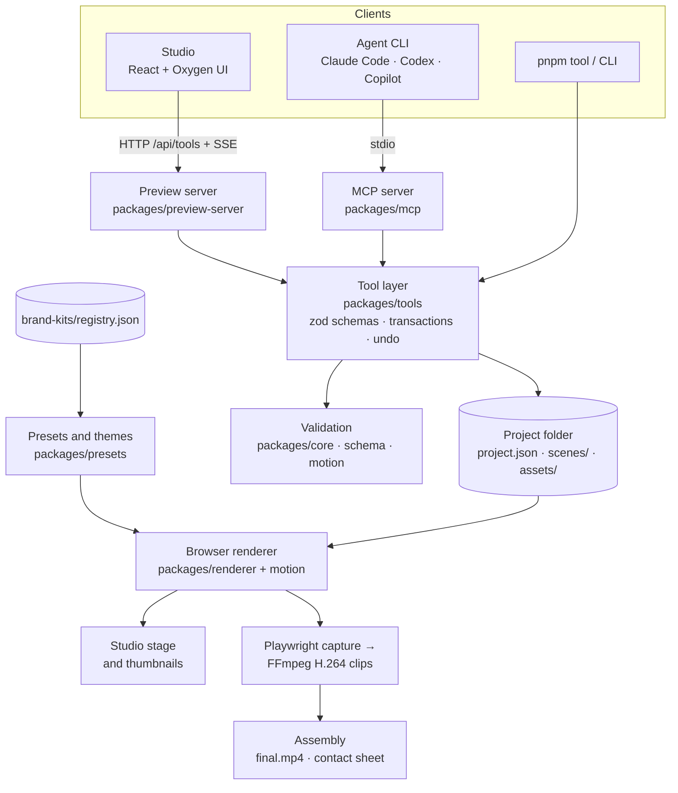

# System overview

JoeFlux is a set of small Node packages around one idea: **a video is a folder of JSON scenes evaluated by frame**. Every editor, from the Studio to an AI agent, changes that folder through one tool layer, and one browser renderer turns it into pixels for both preview and export.

## Packages

| Package | Responsibility |
| --- | --- |
| `core` | Project loading, validation, fingerprints and media-tool discovery. |
| `schema` | Zod schemas for screen scenes and migration of older scene formats. |
| `motion` | Frame evaluation: camera paths, text, backgrounds, layouts, artwork layers, spatial stage, WebGL looks. |
| `composition` | Layered components with timing, layout and locks. |
| `animation-plugins` | Adapters for Anime.js, Motion, Three.js and React Three Fiber, bundled locally. |
| `presets` | Recipes, templates, themes, Oxygen themes and the brand kit registry. |
| `renderer` | The shared browser scene renderer, render server, source-frame decoder and export pipeline. |
| `assembly` | Joins clips with transitions and makes contact sheets. |
| `tools` | The tool registry used by every client. |
| `director` | Briefs, decisions, knowledge references and review records. |
| `agents` | Adapters that run agent CLIs headless and normalize their output. |
| `mcp` | The stdio MCP server and client setup. |
| `preview-server` | The Studio's dev and production servers, session security and live events. |
| `plugins` | The data-only template pack SDK. |
| `cli` | `pnpm run …` commands. |

## Design rules

- **One write path.** Only tools change projects. They validate first and write nothing when the result is invalid.
- **One frame path.** Preview, thumbnails and export call the same browser renderer with an explicit frame.
- **Deterministic frames.** Scenes may not use wall-clock time, timers or unseeded randomness.
- **Source assets are read-only.** Trims, holds and crops are data; decoded frames are cached separately.
- **No baked-in brand.** Logos, colors, fonts and bookends come from brand kits.
- **Silent output.** Audio is rejected at validation and stripped at export.
