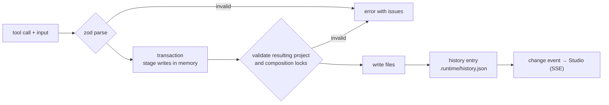

# Tool layer

`packages/tools` is a registry of named tools. Each declares a zod input schema, published as JSON Schema to agents, and an agent-facing description. The Studio, the CLI and MCP clients all call the same registry.

## Transactions

A mutating tool stages reads and writes, including copied media, in a transaction. The runner loads the would-be project, validates it, checks component locks and only then writes. Mutations run one at a time, so the Studio, an agent and the CLI can't interleave half-finished edits.

## Undo

Each change records before and after snapshots in `.runtime/history.json` (up to 100 entries; large files are stored as content-addressed blobs). `history_undo` refuses to overwrite a file that was edited after the change, and an `entryId` lets an agent undo exactly its own change while it is still the latest.

## Optimistic concurrency

`project_get` and `scene_get` return fingerprints. Passing one back with an edit makes the tool reject the change if the file changed in between, instead of silently overwriting someone else's work.

## Live updates

`runner.watch()` reports edits made outside the tools as `external` changes. The preview server streams every change over `GET /api/events`, so the Studio reflects agent and hand edits immediately.

## Studio session security

The preview server listens on loopback only. Each run creates a random session token, passed in the launch link's URL fragment and sent as `x-joeflux-token`; comparisons are constant-time. Cross-site requests, unexpected hosts, malformed or oversized bodies and cookie-based credentials are rejected. Project files reach the page only through dedicated routes, and brand kit files only when they are listed in the registry.
