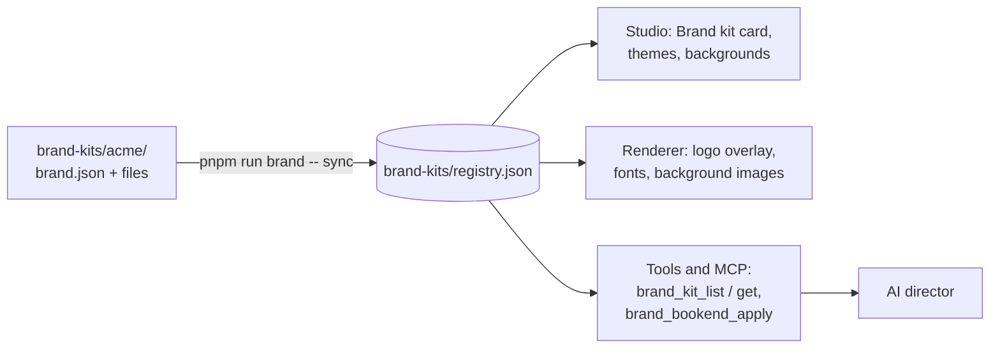

# Brand kits

A brand kit is a folder that holds everything that makes a video yours: logos, fonts, color themes, backgrounds, intro and outro clips, and written guidelines. Put it in `brand-kits/`, run one command, and every project, the Studio, the CLI and the AI director can use it. Nothing about a brand is built into the code, so the same installation can serve any number of brands.

  
<Screenshot src="/img/brand/example-intro.png" alt="Example kit intro" caption="Intro clip from the example kit." />

  
<Screenshot src="/img/brand/example-outro.png" alt="Example kit outro with logo" caption="Outro with the kit logo placed top-left." />

## What a kit provides

| Piece | Where it shows up |
| --- | --- |
| **Logos** for dark and light backgrounds | Overlaid on every shot of a project that selects the kit, matched to each shot's theme mode. |
| **Themes** | The inspector's theme grid, project and scene `theme` values, template previews. |
| **Backgrounds** | The Background gallery, each with a paired theme for readable text. |
| **Fonts** | Loaded offline before any text is measured or drawn. |
| **Bookends** | Intro and outro buttons on the Brand kit card; added as full-screen shots. |
| **Guidelines** | Read by the AI director with `brand_kit_get` before it styles the project. |

## How it flows

`sync` validates every kit and writes the registry the rest of the system reads. See [Brand kit registry](../architecture/brand-kit-registry.md) for the details.

## Next steps

<Cards items={[
  { title: 'Create a kit', text: 'Scaffold a folder, add your files and sync.', to: '/docs/brand-kits/create-a-kit' },
  { title: 'Use a kit in a project', text: 'Select it, pick themes and backgrounds, add bookends.', to: '/docs/brand-kits/use-in-a-project' },
  { title: 'brand.json reference', text: 'Every field, default and validation rule.', to: '/docs/brand-kits/reference' },
]} />
