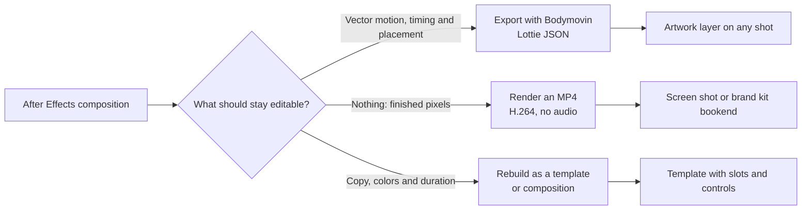

# After Effects and Lottie

JoeFlux does not open `.aep`, `.aet` or `.mogrt` files. You bring After Effects work in through one of three routes, depending on what you need to keep editable.



| Route | Keeps editable | Best for | Limits |
| --- | --- | --- | --- |
| **Lottie layer** | Position, size, timing, speed, opacity | Logo stings, icons, line art, UI micro-animation | No expressions; some effects, masks and 3D layers render differently |
| **Rendered clip** | Trim, timing, framing | Complex comps, particles, 3D, plug-in effects, intros and outros | Pixels are baked; alpha is not composited |
| **Rebuilt template** | Copy, colors, duration, assets | Recurring title, lower-third or reveal designs | Rebuilt by hand or with the director |

## Route 1: Lottie layers

Lottie playback uses the bundled [lottie-web](https://github.com/airbnb/lottie-web) 5.13.0 player (MIT). Each layer seeks to an exact source frame, so preview, scrubbing and export match.

### Prepare the composition

1. Set the composition frame rate to your project's `output.fps` (24 by default) and its size to the area the animation will fill.
2. Keep shapes, solids, masks, trim paths and transforms. Avoid expressions, layer effects, 3D layers, blend modes and third-party plug-ins; lottie-web either ignores them or draws them differently.
3. Convert text to shapes, or export with **Glyphs** enabled, so the result does not depend on installed fonts.
4. Pre-compose the animation and trim the work area to the part you want.

### Export with Bodymovin

1. Install the free [Bodymovin](https://github.com/airbnb/lottie-web) extension for After Effects, then open **Window → Extensions → Bodymovin**.
2. Select the composition and choose a destination folder.
3. In **Settings**, enable **Glyphs** so text is exported as shapes, and choose to include assets in the JSON so any images are embedded. JoeFlux plays Lottie files with expressions turned off, so bake expressions to keyframes (**Animation → Keyframe Assistant → Convert Expression to Keyframes**) before export.
4. Select **Render**. You get one `data.json` file.

JoeFlux accepts Bodymovin JSON with a frame rate (`fr`), in and out points (`ip`, `op`), layers, and only embedded (`data:`) images. Files that reference external images are rejected on import.

### Import and place it

In the Studio, select a shot, open the **Art** tab and choose **Import artwork**. Or copy the file in from the command line:

```bash
pnpm tool projects/my-video asset_import '{"source":"/absolute/path/logo-sting.json","name":"logo-sting"}'
```

Then add a layer to the shot. Coordinates are fractions of the stage:

```json
"layers": [
  { "type": "lottie", "asset": "logo-sting", "x": 0.72, "y": 0.06, "width": 0.22, "height": 0.22, "startFrame": 0, "endFrame": 48, "speed": 1, "opacity": 1 }
]
```

| Field | Meaning |
| --- | --- |
| `x`, `y`, `width`, `height` | Placement as 0–1 fractions of the stage. The layer must stay inside the frame. |
| `startFrame`, `endFrame` | When the layer is visible, in shot frames. |
| `speed` | Playback rate from 0.1 to 4. At 1, one source frame plays per output frame at the file's own frame rate. |
| `opacity` | 0–1. |

A shot can hold up to 12 artwork layers, mixing Lottie and SVG. Layers draw above the WebGL look pass, so they are never graded or blurred.

You can also ask the director: "Import `logo-sting.json` and play it in the top-right corner for the first two seconds."

### Check the result

Render the first, middle and last frames of the layer (`render_frame`, or scrub on the stage) and look closely at masks, text and any effects. If something renders differently, simplify it in After Effects or use a rendered clip instead.

## Route 2: rendered clips

Use this route when the composition relies on effects, particles, 3D or plug-ins that Lottie can't carry.

1. In After Effects or Adobe Media Encoder, render H.264 MP4 at the project's frame size and frame rate. If you render ProRes or another intermediate, convert it:

   ```bash
   ffmpeg -i intro.mov -an -c:v libx264 -pix_fmt yuv420p -crf 18 -r 24 intro.mp4
   ```

2. Use the clip in one of two ways:
   - **As a shot.** Import it as an asset and add a full-screen screen shot (`"presentation": "fullscreen", "fit": "contain"`). Trim it with `playback.startSeconds` and `endSeconds`.
   - **As a brand bookend.** Put it in a brand kit's `bookends/` folder and list it in `brand.json`. Every project using the kit can then add it as its intro or outro. See [Create a brand kit](../brand-kits/create-a-kit.md).

Exports are always silent, so audio in the clip is ignored. Transparency isn't composited: render the clip over its final background, or use a Lottie layer for motion that must sit over other shots.

## Route 3: rebuild a template

For a design you'll reuse with different copy, such as a title card, lower third or product reveal, rebuild it as an editable template. Ask the director to adapt it, or use the `video-production` skill's template-adaptation guide yourself:

1. Note four to six timecodes in the original: before movement, anticipation, peak, reveal, settled pose and exit.
2. Map each After Effects technique to its equivalent:

   | After Effects | JoeFlux |
   | --- | --- |
   | Position, scale and opacity keyframes | Camera shots, component timing or an Anime.js timeline |
   | Shape reveal or track matte | Canvas clipping or SVG masks in a custom module |
   | Text animator | `textAnimation` templates or the `harness/title` component |
   | Parent or null | One transform group in a custom module |
   | 3D camera and lights | A Three.js or React Three Fiber scene |
   | Glow, blur or particles | The WebGL compositor, background styles or seeded particles |

3. Rebuild the hardest two to four seconds first and compare them side by side with the original.
4. Expose copy, colors and duration as template slots and controls, then publish the template in a [template pack](template-packs.md).

## Rights

A template's license covers what you may do with its exports; it doesn't come with the software. Before using a marketplace template, stock animation or Lottie file, check that its license allows your use and record where it came from. Animations you design yourself, or that are made for your brand, can live in your brand kit.
